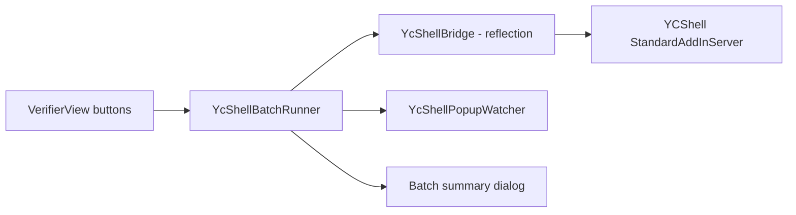

# Implementation Plan: Regenerate All / Upload All Surfaces

Status: planned, not started. Quest: `Q-20261022-221452-dd97`.

## 1. Goal

A unit has about 40 surfaces. The detailer corrects them in UCV, then today has to open each surface in Inventor and
press **Regenerate Channel Features**, then **Upload Changes**, one surface at a time: about 80 rounds of clicking.

UCV gets two buttons. Both act only on **changed surfaces**: surfaces with at least one part marked as an SQ change
(section 4.0). Untouched surfaces are left alone.

1. **Regenerate changed surfaces**: runs YCShell's Regenerate Channel Features on each changed surface, one after
   another.
2. **Upload changed surfaces**: opens YCShell's upload window once, listing the changed surfaces, so the detailer
   reviews it and presses Upload once.

Both end with a summary in UCV saying which surfaces went through and which need a look.

## 2. Ground rules

- **YCShell is not ours.** No changes to its source or binary. UCV drives it by reflection, in-process, against
  whatever YCShell build is installed. Our local copy of the source
  (`MOM_ISG/InventorAddIn/InventorAddIn_MOM_YCShell`) is slightly old, but the product owner confirms its behaviour
  has not changed.
- **One at a time.** Inventor runs on one thread, and both operations change and save the same files. "Batch" means
  a queue: surfaces one after another, never in parallel, and Upload never while Regenerate is running.
- **Decisions stay with the detailer.** UCV never answers a YCShell Yes/No question. It may close boxes that only
  report information (section 5.3).
- **Check before starting.** If any YCShell member UCV relies on is missing or has a different shape, UCV says so and
  does nothing. It never fails halfway through a unit because of this.

## 3. What YCShell does today

All in `InventorAddIn_MOM_YCShell/StandardAddInServer.cs` (class `StandardAddInServer`, add-in id
`{8056411e-f31d-4ec5-a172-4a874bbea3aa}`, `Automation` returns null) unless noted. Line numbers are from our copy.

| Piece | Member | Notes |
|---|---|---|
| Open surface list | `private List<Types.CAssembly> m_OpenAssemblyList` | Filled by `ApplicationEvents_OnOpenDocument` for every ISG surface or composite that is opened, including referenced ones. Each entry is loaded through `LoadAssemblyDocument`. |
| Open part list | `private List<Types.CPart> m_OpenPartList` | Upload needs this. |
| Inventor wrapper | `private MOMInventor.CInventorInstance m_InventorInstance` | Upload needs this. |
| Active surface | `private Types.CAssembly m_ActiveAssembly` | Follows the active / in-place-edited document. Both buttons use it. The batch does **not**: it passes each surface directly. |
| Regenerate button | `ISGOperations_FoamAndSnaplockHoles_OnExecute` (2314) | `RunOperation(m_ActiveAssembly, RegenerateFoamAndSnaplockHoles)` |
| Regenerate work | `private void RegenerateFoamAndSnaplockHoles(object item, CUtility.DelegateSetStatus setStatus)` (3602) | Takes the surface as `item`. Calls `ReturnToTop()`. Walls and indoor roofs go through the generator. Sloped roofs go through `RegenerateOutdoorEngagementAndOrientationHoles` (4011). Other surface types are refused with a box. **Saves as it goes** (confirmed by the spike): each new channel part is saved with status `New`, and the surface assembly is saved after each replaced channel is deleted (`finishSetupOfOccurrenceCreatedInGenerator`, `removeOccurrenceReplacedInGenerator`). There is no undo by closing without saving. |
| Progress window | `private void RunOperation(object item, CFrmRunOperation.DelegateOperation op, bool checkForSuppressedOccurrences = true)` (4967) | Modal progress window. The work runs on a thread-pool thread. Returns when the work ends. Its suppressed check looks at `m_ActiveAssembly`, not `item`, so the batch passes `false` and checks for itself. |
| Upload button | `MOM_Upload_OnExecute` (2201) | Checks for suppressed parts (`HasSuppressedOccurrences`) and structural parts with holes, then sets `m_InUpload = true`, runs `new Upload.CFrmUploadChanges().Start(m_InventorInstance, assemblies, m_OpenPartList, SetSuppressDocumentEvents)`, then sets `m_InUpload = false`. |
| Upload window | `Upload/CFrmUploadChanges.xaml.cs` | **Takes a list of assemblies.** A code comment says uploading many at once used to be a feature. Loads the BOM list, then waits for the Upload button. On Upload it saves every dirty part and assembly, then uploads. If MOM gives a surface a new part number, the window saves a copy under that number, closes and reopens it, deletes the old file, and replaces the occurrence in any **composite** assembly that is in the list. |

Pop-ups in Regenerate: about 22 `MessageBox.Show` calls. Around half are Yes/No decisions, shown only when channels
are missing or a step would remove all foam holes. The other half are OK-only. Each surface that completes ends
with an OK box: `"<n> Channel Features have been recreated/replaced"`, captioned `"<SurfaceType> : <PartNumber>"`.

## 4. Design

### 4.0 Which surfaces count as changed

UCV's write-back stamps every edited part with `MOM_DATA.DOCUMENT_STATUS = "Changed_SQ"` and
`MOM_DATA.PART_SOURCE = "SQPart"` (`IptPropertyWriter`, step 4). YCShell reads the same attribute: its upload window
marks the part "Changed Part [SQ]" (`CPartWrapper.IsChanged_SQ`) and counts the surface as changed.

- **Rule:** a surface is changed when at least one of its parts has `DOCUMENT_STATUS = Changed_SQ`. That covers parts
  changed in UCV and parts marked by YCShell's own **Mark Selected Components As Changed**.
- **Reading it:** UCV does not read `DOCUMENT_STATUS` yet. Add it to `IptPropertyMapper` / `IptPropertyReader`
  (attribute set `MOM_DATA`), so every scan knows each part's status. No reflection is needed for this. It also
  works in the headless scan tool.
- **Showing it:** the surface list shows a "changed" badge, counting the changed parts on each surface. Both buttons
  show the count ("Regenerate 6 changed surfaces"). They are disabled when nothing is changed.
- **Freshness:** UCV re-scans after it writes parts, so the badge is current right after a write. If someone marks
  parts changed in YCShell directly, the badge is only current after the next UCV scan. The button confirmation
  re-reads the status of the listed surfaces before starting.
- **Composites are never surfaces.** YCShell's list includes the unit (`FINAL.IAM`), which reports every changed
  part below it. It also keeps stale entries from units opened earlier in the session. Select only the
  non-composite surfaces that the active unit references (spike finding, section 6.2).
- **Channels added by patterning or copying** (the detailers' easiest way to add channels). YCShell's
  `AssemblyEvents_OnNewOccurrence` handles a second occurrence of an existing part in one of two ways:
  - **Library or cut-to-length part** (normal channels): `MakeOccurrenceUnique` copies it to `<name>_N.IPT` with its
    own calculator spreadsheet and status **`New`**. A rule that only looks at `Changed_SQ` misses these surfaces.
  - **Any other part:** no new file, and the part's status does not change. A part-status rule misses it.
  - **Either way, YCShell marks the occurrence:** `OnNewOccurrence` sets the occurrence attribute
    `MOM_DATA.OCCURRENCE_IS_NEW = 1` before deciding how to handle the part. A successful upload resets it to 0
    (`CFrmUploadChanges`, `IsNewOccurrence = false`). **Confirmed on the test unit (2026-10-23):** in the spike copy,
    the product owner patterned a channel on surface 0019. The new occurrence `[0002/B] 091Z010068-0020:2 - NEW`
    reuses part `091Z010068-0020.IPT`, whose status stayed `NoChange`, but the occurrence carries
    `OCCURRENCE_IS_NEW = 1`. In the original unit, every surface reads 0 after its upload.
- **Channels** are identified by the occurrence attribute `MOM_DATA.PART_TYPE = CHANNEL`. YCShell stamps it on
  every occurrence; other values seen are `SKIN`, `LINER`, `ANGLE`, `SUBFLOOR`, `FLOOR`, `FILLER_PLATE` and so on.
  Patterned channels carry it too (`USER_ADDED` sub-type).
- **Two rules (product owner, 2026-10-23).** An SQ change to a skin or liner does not need Regenerate; Upload picks
  it up on its own. Regenerate is only needed when channels were **added, moved or modified**, because snaplocks
  (and so insulation on the drawing) follow the channels.
  - **Upload changed:** a surface is changed when any of these holds. This is YCShell's own idea of a change, plus
    the new-occurrence marker.
    - any occurrence has `OCCURRENCE_IS_NEW = 1`;
    - the surface has `HAS_DELETED_COMPONENTS = 1` or `HAS_TRANSFORMED_COMPONENTS = 1`;
    - any part is not `NoChange`.
  - **Regenerate changed:** a surface needs Regenerate when any of these holds.
    1. **Channel added:** a `CHANNEL` occurrence has `OCCURRENCE_IS_NEW = 1`.
    2. **Channel reshaped:** a `CHANNEL` occurrence's part is `Changed_SQ` or `Changed_Parameter`, **unless** UCV's
       write-back changed only gauge / material. Product owner, 2026-10-23: gauge or material edits alone do not
       need Regenerate. UCV stamps `Changed_SQ` just as YCShell does for a reshape, so UCV keeps a **part write record**
       (`.ucv_part_writes.json` next to the unit IAM). It holds the status and file version before UCV first wrote the
       part, and the file version right after UCV's last save. A channel counts as a material-only edit when its file
       is still at UCV's version **and** it was `NoChange` (and had no unsaved edits) before UCV wrote it. Any later
       save, or an earlier change, counts as a reshape.
       - **Parts UCV wrote before these records existed** (`IS_HARD_EDITED`, no record) can't be told apart. They
         read "channel edited (gauge/material or reshape, can't tell)" and are ticked by default (product owner
         confirmed, 2026-10-23). On the test unit, that is 0073, 0074, 0078 and 0080.
       - A gauge change made in YCShell's own parameter editor (`Changed_Parameter`) also counts as a reshape. UCV
         cannot see which parameter changed.
    3. **Channel moved (or deleted):** YCShell only records these per surface (`HAS_TRANSFORMED_COMPONENTS`,
       `HAS_DELETED_COMPONENTS`; see `AssemblyEvents_OnOccurrenceChange` and `OnDelete`), so a moved skin and a moved
       channel look the same. UCV closes the gap with its own **channel fingerprint** (below). Without a fingerprint,
       a surface with only these flags is listed as **"components moved or deleted, may not be channels"** and is
       **ticked by default**. The product owner prefers regenerating one surface too many to missing one
       (2026-10-23).
  - **Example from the test unit:** 0091's changes are 5 `SUBFLOOR` SQ parts and no channels. It needs Upload but
    not Regenerate.
- **Channel fingerprint (UCV's own record).** After UCV regenerates a surface, it stores the surface's channel
  occurrences: occurrence id (`OCCURRENCE_ID`), part file and position (transformation matrix, rounded). The record
  lives alongside UCV's existing unit persistence. Next time:
  - **Fingerprint unchanged:** the surface is "already regenerated", even though its replacement channels still carry
    `OCCURRENCE_IS_NEW` and `New` until upload. This stops a second **Regenerate changed** from redoing it.
  - **Fingerprint different** (a channel added, removed or moved since): the surface needs Regenerate, with the
    channel named. This also catches moved channels precisely.
  - **No fingerprint yet** (never regenerated through UCV, or regenerated with YCShell's own button): rules 1 to 3
    apply.
- **Limitation:** YCShell's markers come from its event handlers. Channels added or moved while YCShell is not loaded
  (or before the detailer logs into the MOM tools) are not marked. A UCV fingerprint still catches them once one
  exists. List this in `known_issues.md`.

### 4.1 `Operations/YcShellBridge.cs`: the only place that knows YCShell's internals

- `static YcShellBridge? Connect(Application app, trace, out string problem, ...)`
  - The YCShell add-in (`{8056411E-F31D-4EC5-A172-4A874BBEA3AA}`) must be installed and activated.
  - **Correction (spike build):** Inventor's `ApplicationAddIn` has **no `AddInServer` property**, and YCShell's
    `Automation` returns null, so the earlier idea (also in `library_part_writeback_implementation_plan.md`) does not
    compile. `YcShellLocator` finds the server object through the event handlers YCShell attached to Inventor
    objects instead: its Regenerate / Upload buttons' `OnExecute` and `ApplicationEvents`. In one AppDomain, UCV
    fetches the same COM wrappers YCShell holds. The interop event provider kept on each wrapper
    (`Marshal.GetComObjectData`) lists the delegates, and YCShell's delegates have its `StandardAddInServer` as
    `Target`. This depends on both add-ins sharing an AppDomain, which the spike checks. **If it fails**, the fallback
    is to activate each surface for in-place editing and run YCShell's button with
    `ControlDefinition.Execute2(true)`. That covers Regenerate one surface at a time, but not a single multi-surface
    upload.
  - Resolve every member listed in section 3 with `BindingFlags.NonPublic | Instance`, plus the nested delegate
    types `CommonUI.CFrmRunOperation+DelegateOperation` and
    `Upload.CFrmUploadChanges+DelegateSetSuppressDocumentEvents`. Check each parameter list.
  - Any miss returns null, and `problem` names the member. In the UI: "YCShell version not supported: <member>".
    Log the YCShell assembly version either way.
- `IReadOnlyList<YcSurface> GetOpenSurfaces()`: reads `m_OpenAssemblyList` and returns a handle for each entry
  (full file name, is-composite, and the opaque `CAssembly` object).
- `IReadOnlyList<string> FindUploadBlockers(YcSurface s)`: the same two checks `MOM_Upload_OnExecute` does, for one
  surface:
  - **Suppressed parts:** `Inventor_AssemblyComponentDefinition.GetSuppressedOccurrenceDescriptions` (public static
    in YCShell).
  - **Structural parts with holes:** filter the surface's part occurrences on `PartConstructionType == STRUCTURAL`,
    map them through `CUtility.GetPartsForOccurrences`, then call the internal `HasHoles` extension.
- `void Regenerate(YcSurface s)`: build a `DelegateOperation` bound to the add-in server's
  `RegenerateFoamAndSnaplockHoles` (`Delegate.CreateDelegate`), then call `RunOperation(s.Assembly, op, false)`. This
  shows YCShell's own progress window. The call blocks until the surface is done.
- `void OpenUploadWindow(IReadOnlyList<YcSurface> surfaces)`: set `m_InUpload = true`, construct `CFrmUploadChanges`
  by reflection, call `Start(m_InventorInstance, list, m_OpenPartList, SetSuppressDocumentEvents delegate)`, and set
  `m_InUpload = false` in `finally`. This blocks until the detailer closes the window. `list` is a
  `List<Types.CAssembly>` built by reflection (`typeof(List<>).MakeGenericType(...)`).

Nothing outside the bridge touches reflection.

### 4.2 `Operations/YcShellBatchRunner.cs`: the queue

- Input: the unit UCV is checking. Its surface IAM paths are the `SourceSurfaceIam` values of the unit's surface
  rows, and its root document is what `FindUnitDocument()` returns.
- **Select:** keep only the changed surfaces (section 4.0).
- **Match:** pair each selected surface with a YCShell entry by full path (case-insensitive, trimmed, which is the
  same rule YCShell uses). A surface with no YCShell entry is reported as "not loaded by YCShell" and skipped.
- **Regenerate changed:**
  1. Confirm with the detailer: "Regenerate channel features on N changed surfaces?", listing the surfaces and how
     many changed parts each one has.
  2. Before each surface, check whether the detailer pressed **Stop**. Stop takes effect between surfaces, never
     during one.
  3. Call `bridge.Regenerate(s)`. Catch per surface and record the outcome (section 4.4).
  4. YCShell saves each surface as it regenerates it, so a finished surface stays finished even if the batch is
     stopped. The confirmation says so: there is no undo by closing without saving.
- **Upload changed:**
  1. Refuse if UCV has unsaved verifier edits (reuse `UnsavedWorkPrompt`), or if a regenerate batch is running.
  2. Run `FindUploadBlockers` on every surface. If any surface has blockers, show them all in one list and stop.
     This beats YCShell's own behaviour of stopping at the first problem on one surface.
  3. Call `bridge.OpenUploadWindow(surfaces + the unit's composite assembly)`. The composite is included so a surface
     that gets a new part number is swapped in the unit, not orphaned (see section 6, question 2). YCShell's window
     lists only the surfaces, because it skips composites, and the detailer presses Upload once.
  4. When the window closes, re-scan the unit in UCV, as UCV already does after writing parts.

### 4.3 `UI/YcShellPopupWatcher.cs`: fewer clicks, no guessed answers

While a regenerate batch runs, a watcher looks for YCShell message boxes in Inventor's process: top-level `#32770`
windows whose caption matches `"<SurfaceType> : <PartNumber>"` for the current surface. It polls every 250 ms, or
uses a `WH_CBT` hook if polling proves unreliable.

- **Closes automatically:** OK-only boxes whose text matches the known information-only messages. These are
  "Channel Features have been recreated/replaced" and the sloped-roof notices "Surface is a sloped/outdoor Roof". The
  message text is copied into the batch log, so nothing is lost.
- **Never touches:** any box with Yes/No buttons, and any box it does not recognise. Those wait for the detailer
  exactly as today. The watcher records the question and the detailer's answer for the summary (for example, "Wall
  12: snaplock-only chosen, 1 perimeter channel missing").
- Off switch: a setting **Close YCShell info boxes automatically** (default on). With it off, every box waits for
  the detailer.

### 4.4 Results and summary

Each surface ends up as one of:

- **Done**: the completion box was seen.
- **Done with choices**: the detailer answered a question.
- **Skipped by YCShell**: unsupported surface type, no generator, or the detailer answered No to everything.
- **Not loaded**
- **Failed**: an exception, with its message.

The summary dialog lists the surfaces grouped by outcome. Rows are clickable and select the surface, as in the
existing surface list. The summary is also written to the UCV debug log.

### 4.5 UI

- Two buttons in the verifier header, next to Write changes: **Regenerate changed (N)** and **Upload changed (N)**.
  Both are disabled when the bridge failed to connect (tooltip says why), when no unit is loaded, when no surface is
  changed, or while either batch runs.
- While a batch runs, reuse the v1.0.30 busy panel ("Regenerating 7 of 40: <surface>") with a **Stop** button.
  YCShell's own progress window still appears on top for each surface.

## 5. Threading

- Everything runs on Inventor's main thread, which is where UCV's button handlers already run. YCShell's own windows
  do the background work and pump messages, the same as when a person presses the buttons.
- Inventor stays responsive between surfaces: UCV yields one dispatcher frame between surfaces so the busy panel and
  Stop button update.
- Document events stay on. YCShell relies on them while regenerating (it switches them off around channel placement
  itself) and while uploading (it reopens assemblies).

## 6. Questions for the spike (Step 0)

0. Can UCV reach YCShell's server object at all (same AppDomain, event-handler route)? See section 4.1. The spike
   checklist is `ycshell_spike_checklist.md`.

1. With the unit IAM open, does `m_OpenAssemblyList` contain every surface, or only documents opened on their own?
   The `OnOpenDocument` code suggests every surface, but this needs checking.
2. Is the unit IAM a composite assembly (`IsCompositeAssembly`)? Does passing it to the upload window make
   new-part-number surfaces get replaced in the unit? If not, **Upload all** is limited to surfaces whose part number
   is already final, and new surfaces are listed as "upload individually".
3. Does `ReturnToTop()` from inside the unit behave correctly when the surface being regenerated is not the one being
   edited in place?
4. Confirm the exact text of the outdoor-roof completion box (`StandardAddInServer.cs` around line 4326) and of
   every OK-only box the watcher may close.
5. Time per surface, to set expectations for a 40-surface unit.
6. Should parts with status `New` or `Changed_Parameter` also make a surface count as changed? Product owner to
   decide. The default is `Changed_SQ` only.
7. ~~After a successful upload, does YCShell reset `DOCUMENT_STATUS`?~~ **Yes**: uploaded parts go back to
   `NoChange` (section 6.1).

### 6.1 Test unit

`C:\Users\jbrow263\ISG\ISG Test Units\Hole Pattern Tiger Team\Unit` (the "Hole Pattern Tiger Team" FINAL unit).
Read-only inspection through Apprentice on 2026-10-22:

- **Unit assembly:** `FINAL.IAM` has `MOM_DATA.IS_COMPOSITE_ASSEMBLY = 1`, so the first half of question 2 is
  answered. It references 32 surface IAMs directly. `Base\FINAL.IAM` is a second composite, referencing the 5 base
  surfaces.
- **Changed surfaces:** 11 surfaces have `Changed_SQ` parts (42 parts in all). Every other part reads `NoChange`.

  | Surface | Changed_SQ | NoChange |
  |---|---|---|
  | 0003 | 2 | 12 |
  | 0006 | 2 | 12 |
  | 0009 | 3 | 12 |
  | 0055 | 1 | 11 |
  | 0059 | 1 | 11 |
  | 0065 | 2 | 9 |
  | 0068 folder, `391Z010068-0091.IAM` | 4 | 12 |
  | 0073 | 6 | 7 |
  | 0074 | 8 | 3 |
  | 0078 | 5 | 5 |
  | 0080 | 8 | 8 |

- **Orphaned surface:** folder `391Z010068-0068` holds `391Z010068-0091.IAM`, not `-0068.IAM`. The product owner
  uploaded this surface on its own on 2026-10-22 (about 07:58) to check that changes reached MOM. MOM gave it a new
  part number. YCShell saved it as `-0091.IAM` and deleted `-0068.IAM`, but `FINAL.IAM` was not part of that upload,
  so FINAL still points at the missing `-0068`. **This is normal today:** after uploading a renamed surface, the
  detailer relinks it in the unit by hand and saves. It has not been relinked here, so opening FINAL will not load
  this surface, and the batch would report it as "not loaded".
  - **What it means for the batch:** passing `FINAL.IAM` (composite) to the upload window should make YCShell do
    that relink itself (`occ.Replace(new location)` in `DoUpload`). That would save the detailer a manual step per
    renamed surface. The spike must confirm this on the copy. If it does not work, the batch summary must list every
    renamed surface as "relink in FINAL and save".
- **Duplicate names:** `391Z010068-0067.IAM` and `-0071.IAM` exist both at the top level and under `Base\`. Check
  which copy FINAL resolves to before matching surfaces by path.
- **Upload resets the change marker (answers question 7):** the copies of the 4 SQ parts that the 07:58 upload saved
  (kept in `391Z010068-0068\OldVersions`, `*.0074.IPT`) read `DOCUMENT_STATUS = NoChange`, with `PART_SOURCE = SQPart`
  kept. So after a successful upload, a surface drops off the changed list on its own. The same 4 parts read
  `Changed_SQ` again today because they were rewritten at 10:29, after the upload, by a UCV write.
- **No backup:** the unit is not under version control, and Regenerate rewrites channels. Upload writes to MOM /
  MAPICS, so do not press Upload during the spike without agreeing which MOM environment it points at.

**Spike copy:** `C:\Users\jbrow263\ISG\ISG Test Units\Hole Pattern Tiger Team\Unit - Spike Copy`, made 2026-10-22
with robocopy (1,124 files, 440 MB, timestamps kept). The original stays untouched. Checked with Apprentice under
`ISG.ipj`:

- The copy's `FINAL.IAM` resolves all 428 referenced documents **inside the copy**, with no missing references. Its
  `0067` and `0071` resolve to the top-level folders, not `Base\`.
- The copy's `Base\FINAL.IAM` resolves all 74 references to the **original** unit's `Base\` folder, because it stores
  absolute paths. **Do not open or save the copy's `Base\FINAL.IAM` during the spike**, or the original base
  surfaces will change. None of the 11 changed surfaces is under `Base\`, so the spike only needs the copy's top-level
  `FINAL.IAM`.

### 6.2 Spike results (2026-10-23, `Unit - Spike Copy`)

Log: `%TEMP%\UnitConstructionVerifier\ycshell_spike_20261023_064133.txt`. Installed YCShell build:
`2022.9.9.1435` (`%LOCALAPPDATA%\Autodesk\ISG\MOM_YCShell\AddIn`).

- **Question 0, reaching YCShell: yes.** Both add-ins run in `DefaultDomain`. The server was found through YCShell's
  `ApplicationEvents.OnOpenDocument` handler. Every member in section 3 resolved, including
  `CFrmUploadChanges.Start`. Looking the buttons up by their YCShell IDs failed with `E_FAIL`, so YCShell registers
  them under other internal names. That does not matter for the bridge, but the `Execute2` fallback would need the
  real names.
- **Question 1: yes.** FINAL references 33 sub-assemblies (0091 had been relinked in the copy), and all 33 are in
  YCShell's list and loaded. The list has 35 entries: the 33 surfaces, FINAL itself (`composite=True`), and a stale
  unloaded entry from another unit opened earlier (`...\20209\...\391-10018-002.iam<iLogic>`).
- **Question 2, first half: yes.** YCShell sees FINAL as composite.
- **Question 3: no effect seen.** The active edit document was FINAL before and after. YCShell's active assembly
  stayed FINAL.
- **Question 5:** surface 0055 (1 changed part) took **131.7 s**, including the time to click the one completion box.
  The box read "4 Channel Features have been recreated/replaced", captioned `Wall : 391Z010068-0055`, which is the
  format section 4.3 expects. Rough estimate for this unit: about 25 minutes for 11 changed surfaces. Larger
  surfaces may take longer.
- **Regenerate saves:** see section 3. Part status on 0055 went from `Changed_SQ=1 NoChange=11` to
  `Changed_SQ=1 New=4 NoChange=7`: 4 channels were replaced by 4 new parts. The surface was not dirty afterwards.
- **Second run, unchanged surface 0019** (`NoChange=10`): 58.7 s. Afterwards it read `New=2 NoChange=8`. Regenerate
  replaces channels even on an untouched surface, and that makes the surface "changed" for upload. This supports
  regenerating only surfaces with `Changed_SQ` parts.
- **Part totals stayed the same** on both surfaces (12 and 10), so each new channel replaced an old one rather than
  being added. The "after" status is read as soon as YCShell returns. The product owner notes that library parts
  and added channels may show up later: press **Refresh** a minute or two later and compare before trusting the
  counts.
- **Still open:** question 2, second half (does passing FINAL to the upload window relink a renamed surface?), and
  question 6.

### 6.3 Step 0.5 results (2026-10-23)

Code is on branch `ucv/batch-regenerate-upload`:

- `Models/SurfaceChanges.cs`: change-state model, both rules (`SurfaceChangeRules`) and `ChannelFingerprint`.
- `Extraction/SurfaceChangeReader.cs`: reads the markers from a live surface IAM. The UCV scan now fills
  `IptScanResult.Surfaces`.
- `Persistence/ChannelFingerprintStore.cs`: the `.ucv_channel_fingerprints.json` sidecar next to the unit IAM.
- 12 tests in `SurfaceChangeRulesTests`. The full suite passes: 173 tests.
- The YCShell Spike window now shows each surface's Regenerate / Upload verdict with reasons. A spike regenerate
  records the channel fingerprint.

The compiled rules were run over both test units (markers read with Apprentice, read-only):

| Unit | Upload | Regenerate |
|---|---|---|
| Original | 11 surfaces (all with changed parts) | 4: 0073, 0074, 0078, 0080 (channel parts edited) |
| Spike copy | same 11 + 0019 | same 4 + 0019 (patterned channel) + 0055 (channels the spike regenerate replaced, with no fingerprint) |

Skin, liner and subfloor-only changes (0003, 0006, 0009, 0055 original, 0059, 0065, 0091) go to Upload only.

**Answered:** gauge / material edits alone do not need Regenerate (rule 2 above, with UCV's part write record).
After that change, the 4 surfaces read "can't tell" and are ticked by default, because their parts were written
before UCV kept records. The suite is now at 181 tests.

**Not done in 0.5:** the surface-list badges. They move to Step 2 with the buttons. The Apprentice scan tool
(`ucv-scan`) does not fill `Surfaces` yet.

### 6.4 Steps 1 to 3 built (2026-10-23, not yet run in Inventor)

**Regenerate changed…** is a new footer button. It shows the number of surfaces that need it, from the last scan
and UCV's own records.

1. **Checks before it starts:** it needs a scan, and no staged part edits (Regenerate replaces channel parts). It
   connects to YCShell. If YCShell can't be reached, it says why, with details in the debug log.
2. **Review panel** (in the verifier, like the write review): every scanned surface and why it needs Regenerate.
   - Surfaces whose channels changed are ticked. Uncertain ones are orange; surfaces YCShell has not loaded are red
     and can't be ticked.
   - **Close YCShell's information boxes automatically** (on by default).
   - The panel says that YCShell saves as it goes.
3. **The run** (`RegenerateBatchRunner`): surfaces one after another.
   - A surface with suppressed parts is skipped with a reason, instead of stalling on YCShell's dialog.
   - **Stop** is in a small always-on-top window on its own thread (`BatchProgressWindow`). YCShell's modal progress
     dialog disables the verifier, so Stop has to live elsewhere. Stop takes effect after the current surface.
4. **Message boxes** (`YcShellMessageWatcher`): every box YCShell shows is recorded.
   - Only known OK-only notices are closed: the completion message and the sloped-roof notice.
   - Yes/No questions and unknown wording are never touched.
   - Closing presses the box's own OK button, and repeats until the box is gone. A close posted the moment the box
     appeared was ignored in testing.
5. **After each finished surface:** its channel fingerprint is recorded.
6. **After the run:** the unit is re-scanned, and a summary lists the surfaces by outcome, problems first. The
   outcomes are Failed, Not regenerated by YCShell, Skipped, Done with your answers, Done, and Not run. The summary
   is also written to the debug log.

Tests: `RegenerateBatchTests` (message classification, outcomes, runner order / Stop / skip / failure, review list)
and `YcShellMessageWatcherTests` (real Win32 message boxes shown from a worker thread: closes the completion box,
leaves a Yes/No question alone, closes nothing when auto-close is off). 192 pass.

### 6.5 Field test of Regenerate changed (2026-10-23, spike copy)

From the product owner's run and the UCV debug log:

- **Run 1 (09:44):** 6 of 6 surfaces regenerated: 0019, 0055, 0073, 0074, 0078 and 0080. Each took between 6 and
  60 s. Every completion box was closed by UCV. No Yes/No questions came up.
- **Run 2 (09:47):** 0019 done, then **Stop** worked. 0055 was listed as "Not run (stopped)".
- The summary listed the surfaces with times, as designed.
- **Bug found:** a channel patterned on 0063 *after* the verifier's last scan was not offered. The button and review
  panel used the scan's markers, and 0063 only appeared after a later run's closing re-check. **Fixed:** pressing
  **Regenerate changed…** now re-reads every open surface's markers live from Inventor before building the review,
  and updates the button count. The button label itself still reflects the last scan or press until then.
- **Also fixed:** the test suite wrote fake errors into the real UCV debug log under `%TEMP%`. Tests now use their
  own temp folder (`TestTempFolder`).
- **Not yet seen in Inventor:** a YCShell Yes/No question during a batch. It is covered only by the Win32 watcher
  tests.

### 6.6 Step 4 built: Upload changed (2026-10-23, not yet run in Inventor)

**Upload changed (N)…** is a footer button next to Regenerate changed. It shares the review panel, which now
serves both batches.

1. **Review:** the same checks before it starts, and the same live re-read of every surface.
   - Every surface is listed with its Upload reasons, and surfaces with any change are ticked.
   - A ticked surface whose channels still need Regenerate is orange: "still needs Regenerate". It stays ticked;
     uploading is the detailer's call.
   - The panel says the unit (`FINAL.IAM`) goes along when YCShell has it loaded as a composite.
2. **Blocker check across all ticked surfaces**, the same two checks YCShell's own Upload button makes
   (`UploadBlockers`):
   - suppressed parts;
   - structural parts with holes. These are occurrences with `MOM_DATA.CONSTRUCTION_TYPE = STRUCTURAL`, tested with
     **YCShell's own** `Inventor_PartDocument.HasHoles` (reached by reflection).

   Any blocker stops the whole upload, with the list. That is stricter than YCShell's first-problem-only message.
3. **One YCShell upload window** (`YcShellBridge.OpenUploadWindow`) for the ticked surfaces **plus the unit
   composite**. It is opened as YCShell's button does: `m_InUpload` is set while the window is open (cleared even if
   it fails), and YCShell gets its own part list and `SetSuppressDocumentEvents`. The detailer reviews and presses
   **Upload** there.
4. **After the window closes:** the unit is re-checked, and a result lists each surface sent:
   - **uploaded**: no longer changed;
   - **renamed by MOM**: the old file is gone, so check that the unit references the new one;
   - **still changed**: not uploaded, or the upload failed. Check YCShell's upload log.

   The result is also written to the debug log.

Tests: upload window call shape (YCShell's own `List<CAssembly>`, instance, part list, delegate, `m_InUpload` during
and after, failure path), YCShell's hole test, the upload review and the after-upload result. 197 pass.

**Open, needs the product owner:** an upload really writes to MOM / MAPICS. Before the first real press: agree which
MOM environment the spike copy may upload to (question 2, second half: does passing FINAL relink a renamed surface).

## 7. Steps

| Step | Work | Done when |
|---|---|---|
| 0 | Spike on a copy of a real unit: a throwaway harness command in UCV that connects the bridge, lists YCShell's surfaces, and regenerates one surface by reflection. Answer section 6. | Answers recorded in this file; plan adjusted. |
| 0.5 | Read part `DOCUMENT_STATUS`, occurrence `OCCURRENCE_IS_NEW` / `PART_TYPE` / `OCCURRENCE_ID`, and the surface's `HAS_DELETED_COMPONENTS` / `HAS_TRANSFORMED_COMPONENTS` during the scan. Add both rules (section 4.0), the channel fingerprint store, and surface-list badges with reasons. Unit tests for both rules and the fingerprint comparison. | On the spike copy, 0019 needs Regenerate (patterned channel), 0091 needs Upload only (subfloor SQ parts), and untouched surfaces need neither. |
| 1 | `YcShellBridge` with connect, member checks and `GetOpenSurfaces`. Unit tests use a fake `StandardAddInServer` type with the same private member shapes, to test resolution and the "member missing" path. | Tests green; connecting in Inventor logs the YCShell version and N surfaces. |
| 2 | `YcShellBatchRunner` regenerate path, Stop, outcomes, summary dialog, header button. | 40-surface unit regenerates with the detailer clicking only YCShell's questions plus each completion box. |
| 3 | `YcShellPopupWatcher` and its setting. | Same unit: only Yes/No questions need a click; the summary shows each one. |
| 4 | Upload-all path: blocker pre-check for all surfaces, one upload window, re-scan. | One window lists all surfaces; a seeded suppressed part blocks the whole batch with a clear list; a clean unit uploads in one press. |
| 5 | `HOW_TO_USE.md`, `RELEASE_NOTES.md`, `known_issues.md` (pop-ups that remain, what happens on unsupported YCShell builds). | Docs match the shipped behaviour. |

## 8. Risks

- **YCShell updates.** A renamed private member disables the buttons, with a clear message rather than damage. The
  member list in section 3 is the contract to recheck whenever YCShell is updated.
- **Pop-up matching by text.** If YCShell's wording changes, the watcher stops closing those boxes and the detailer
  clicks them. This fails safe.
- **Upload's file moves.** This is the riskiest part (section 6, question 2). Step 4 must be tried on a copy of a unit
  before it is used on a live one.
