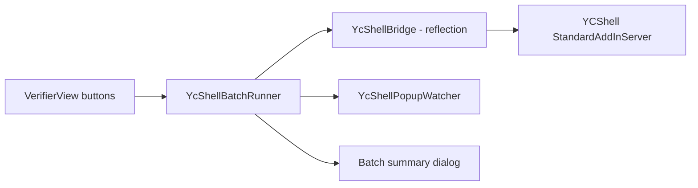

# Implementation Plan: Regenerate All / Upload All Surfaces

Status: planned, not started. Quest: `Q-20261022-221452-dd97`.

## 1. Goal

A unit has about 40 surfaces. The detailer corrects them in UCV, then today has to open each surface in Inventor and
press **Regenerate Channel Features**, then **Upload Changes**, one surface at a time: about 80 rounds of clicking.

UCV gets two buttons. Both act only on **changed surfaces**: surfaces with at least one part marked as an SQ change
(section 4.0). Untouched surfaces are left alone.

1. **Regenerate changed surfaces**: runs YCShell's Regenerate Channel Features on each changed surface, one after
   another.
2. **Upload changed surfaces**: opens YCShell's upload window once, listing the changed surfaces, so the detailer
   reviews it and presses Upload once.

Both end with a summary in UCV saying which surfaces went through and which need a look.

## 2. Ground rules

- **YCShell is not ours.** No changes to its source or binary. UCV drives it by reflection, in-process, against
  whatever YCShell build is installed. Our local copy of the source
  (`MOM_ISG/InventorAddIn/InventorAddIn_MOM_YCShell`) is slightly old, but the product owner confirms its behaviour
  has not changed.
- **One at a time.** Inventor runs on one thread, and both operations change and save the same files. "Batch" means
  a queue: surfaces one after another, never in parallel, and Upload never while Regenerate is running.
- **Decisions stay with the detailer.** UCV never answers a YCShell Yes/No question. It may close boxes that only
  report information (section 5.3).
- **Check before starting.** If any YCShell member UCV relies on is missing or has a different shape, UCV says so and
  does nothing. It never fails halfway through a unit because of this.

## 3. What YCShell does today

All in `InventorAddIn_MOM_YCShell/StandardAddInServer.cs` (class `StandardAddInServer`, add-in id
`{8056411e-f31d-4ec5-a172-4a874bbea3aa}`, `Automation` returns null) unless noted. Line numbers are from our copy.

| Piece | Member | Notes |
|---|---|---|
| Open surface list | `private List<Types.CAssembly> m_OpenAssemblyList` | Filled by `ApplicationEvents_OnOpenDocument` for every ISG surface or composite that is opened, including referenced ones. Each entry is loaded through `LoadAssemblyDocument`. |
| Open part list | `private List<Types.CPart> m_OpenPartList` | Upload needs this. |
| Inventor wrapper | `private MOMInventor.CInventorInstance m_InventorInstance` | Upload needs this. |
| Active surface | `private Types.CAssembly m_ActiveAssembly` | Follows the active / in-place-edited document. Both buttons use it. The batch does **not**: it passes each surface directly. |
| Regenerate button | `ISGOperations_FoamAndSnaplockHoles_OnExecute` (2314) | `RunOperation(m_ActiveAssembly, RegenerateFoamAndSnaplockHoles)` |
| Regenerate work | `private void RegenerateFoamAndSnaplockHoles(object item, CUtility.DelegateSetStatus setStatus)` (3602) | Takes the surface as `item`. Calls `ReturnToTop()`. Walls and indoor roofs go through the generator. Sloped roofs go through `RegenerateOutdoorEngagementAndOrientationHoles` (4011). Other surface types are refused with a box. **Does not save.** |
| Progress window | `private void RunOperation(object item, CFrmRunOperation.DelegateOperation op, bool checkForSuppressedOccurrences = true)` (4967) | Modal progress window. The work runs on a thread-pool thread. Returns when the work ends. Its suppressed check looks at `m_ActiveAssembly`, not `item`, so the batch passes `false` and checks for itself. |
| Upload button | `MOM_Upload_OnExecute` (2201) | Checks for suppressed parts (`HasSuppressedOccurrences`) and structural parts with holes, then sets `m_InUpload = true`, runs `new Upload.CFrmUploadChanges().Start(m_InventorInstance, assemblies, m_OpenPartList, SetSuppressDocumentEvents)`, then sets `m_InUpload = false`. |
| Upload window | `Upload/CFrmUploadChanges.xaml.cs` | **Takes a list of assemblies.** A code comment says uploading many at once used to be a feature. Loads the BOM list, then waits for the Upload button. On Upload it saves every dirty part and assembly, then uploads. If MOM gives a surface a new part number, the window saves a copy under that number, closes and reopens it, deletes the old file, and replaces the occurrence in any **composite** assembly that is in the list. |

Pop-ups in Regenerate: about 22 `MessageBox.Show` calls. Around half are Yes/No decisions, shown only when channels
are missing or a step would remove all foam holes. The other half are OK-only. Each surface that completes ends
with an OK box: `"<n> Channel Features have been recreated/replaced"`, captioned `"<SurfaceType> : <PartNumber>"`.

## 4. Design

### 4.0 Which surfaces count as changed

UCV's write-back stamps every edited part with `MOM_DATA.DOCUMENT_STATUS = "Changed_SQ"` and
`MOM_DATA.PART_SOURCE = "SQPart"` (`IptPropertyWriter`, step 4). YCShell reads the same attribute: its upload window
marks the part "Changed Part [SQ]" (`CPartWrapper.IsChanged_SQ`) and counts the surface as changed.

- **Rule:** a surface is changed when at least one of its parts has `DOCUMENT_STATUS = Changed_SQ`. That covers parts
  changed in UCV and parts marked by YCShell's own **Mark Selected Components As Changed**.
- **Reading it:** UCV does not read `DOCUMENT_STATUS` yet. Add it to `IptPropertyMapper` / `IptPropertyReader`
  (attribute set `MOM_DATA`), so every scan knows each part's status. No reflection is needed for this. It also
  works in the headless scan tool.
- **Showing it:** the surface list shows a "changed" badge, counting the changed parts on each surface. Both buttons
  show the count ("Regenerate 6 changed surfaces"). They are disabled when nothing is changed.
- **Freshness:** UCV re-scans after it writes parts, so the badge is current right after a write. If someone marks
  parts changed in YCShell directly, the badge is only current after the next UCV scan. The button confirmation
  re-reads the status of the listed surfaces before starting.
- **Not included by default:** parts with status `New` or `Changed_Parameter`. YCShell's upload treats those as
  changes too. Whether they should also select a surface is open question 6.

### 4.1 `Operations/YcShellBridge.cs`: the only place that knows YCShell's internals

- `static YcShellBridge? TryConnect(Application app, out string problem)`
  - `app.ApplicationAddIns.ItemById["{8056411E-F31D-4EC5-A172-4A874BBEA3AA}"]` must be present and activated. Take
    `.AddInServer`. It is the real .NET object because both add-ins run in Inventor's process.
  - Resolve every member listed in section 3 with `BindingFlags.NonPublic | Instance`, plus the nested delegate
    types `CommonUI.CFrmRunOperation+DelegateOperation` and
    `Upload.CFrmUploadChanges+DelegateSetSuppressDocumentEvents`. Check each parameter list.
  - Any miss returns null, and `problem` names the member. In the UI: "YCShell version not supported: <member>".
    Log the YCShell assembly version either way.
- `IReadOnlyList<YcSurface> GetOpenSurfaces()`: reads `m_OpenAssemblyList` and returns a handle for each entry
  (full file name, is-composite, and the opaque `CAssembly` object).
- `IReadOnlyList<string> FindUploadBlockers(YcSurface s)`: the same two checks `MOM_Upload_OnExecute` does, for one
  surface:
  - **Suppressed parts:** `Inventor_AssemblyComponentDefinition.GetSuppressedOccurrenceDescriptions` (public static
    in YCShell).
  - **Structural parts with holes:** filter the surface's part occurrences on `PartConstructionType == STRUCTURAL`,
    map them through `CUtility.GetPartsForOccurrences`, then call the internal `HasHoles` extension.
- `void Regenerate(YcSurface s)`: build a `DelegateOperation` bound to the add-in server's
  `RegenerateFoamAndSnaplockHoles` (`Delegate.CreateDelegate`), then call `RunOperation(s.Assembly, op, false)`. This
  shows YCShell's own progress window. The call blocks until the surface is done.
- `void OpenUploadWindow(IReadOnlyList<YcSurface> surfaces)`: set `m_InUpload = true`, construct `CFrmUploadChanges`
  by reflection, call `Start(m_InventorInstance, list, m_OpenPartList, SetSuppressDocumentEvents delegate)`, and set
  `m_InUpload = false` in `finally`. This blocks until the detailer closes the window. `list` is a
  `List<Types.CAssembly>` built by reflection (`typeof(List<>).MakeGenericType(...)`).

Nothing outside the bridge touches reflection.

### 4.2 `Operations/YcShellBatchRunner.cs`: the queue

- Input: the unit UCV is checking. Its surface IAM paths are the `SourceSurfaceIam` values of the unit's surface
  rows, and its root document is what `FindUnitDocument()` returns.
- **Select:** keep only the changed surfaces (section 4.0).
- **Match:** pair each selected surface with a YCShell entry by full path (case-insensitive, trimmed, which is the
  same rule YCShell uses). A surface with no YCShell entry is reported as "not loaded by YCShell" and skipped.
- **Regenerate changed:**
  1. Confirm with the detailer: "Regenerate channel features on N changed surfaces?", listing the surfaces and how
     many changed parts each one has.
  2. Before each surface, check whether the detailer pressed **Stop**. Stop takes effect between surfaces, never
     during one.
  3. Call `bridge.Regenerate(s)`. Catch per surface and record the outcome (section 4.4).
  4. Leave every document unsaved, as YCShell does today. Upload saves them, and the detailer can still undo.
- **Upload changed:**
  1. Refuse if UCV has unsaved verifier edits (reuse `UnsavedWorkPrompt`), or if a regenerate batch is running.
  2. Run `FindUploadBlockers` on every surface. If any surface has blockers, show them all in one list and stop.
     This beats YCShell's own behaviour of stopping at the first problem on one surface.
  3. Call `bridge.OpenUploadWindow(surfaces + the unit's composite assembly)`. The composite is included so a surface
     that gets a new part number is swapped in the unit, not orphaned (see section 6, question 2). YCShell's window
     lists only the surfaces, because it skips composites, and the detailer presses Upload once.
  4. When the window closes, re-scan the unit in UCV, as UCV already does after writing parts.

### 4.3 `UI/YcShellPopupWatcher.cs`: fewer clicks, no guessed answers

While a regenerate batch runs, a watcher looks for YCShell message boxes in Inventor's process: top-level `#32770`
windows whose caption matches `"<SurfaceType> : <PartNumber>"` for the current surface. It polls every 250 ms, or
uses a `WH_CBT` hook if polling proves unreliable.

- **Closes automatically:** OK-only boxes whose text matches the known information-only messages. These are
  "Channel Features have been recreated/replaced" and the sloped-roof notices "Surface is a sloped/outdoor Roof". The
  message text is copied into the batch log, so nothing is lost.
- **Never touches:** any box with Yes/No buttons, and any box it does not recognise. Those wait for the detailer
  exactly as today. The watcher records the question and the detailer's answer for the summary (for example, "Wall
  12: snaplock-only chosen, 1 perimeter channel missing").
- Off switch: a setting **Close YCShell info boxes automatically** (default on). With it off, every box waits for
  the detailer.

### 4.4 Results and summary

Each surface ends up as one of:

- **Done**: the completion box was seen.
- **Done with choices**: the detailer answered a question.
- **Skipped by YCShell**: unsupported surface type, no generator, or the detailer answered No to everything.
- **Not loaded**
- **Failed**: an exception, with its message.

The summary dialog lists the surfaces grouped by outcome. Rows are clickable and select the surface, as in the
existing surface list. The summary is also written to the UCV debug log.

### 4.5 UI

- Two buttons in the verifier header, next to Write changes: **Regenerate changed (N)** and **Upload changed (N)**.
  Both are disabled when the bridge failed to connect (tooltip says why), when no unit is loaded, when no surface is
  changed, or while either batch runs.
- While a batch runs, reuse the v1.0.30 busy panel ("Regenerating 7 of 40: <surface>") with a **Stop** button.
  YCShell's own progress window still appears on top for each surface.

## 5. Threading

- Everything runs on Inventor's main thread, which is where UCV's button handlers already run. YCShell's own windows
  do the background work and pump messages, the same as when a person presses the buttons.
- Inventor stays responsive between surfaces: UCV yields one dispatcher frame between surfaces so the busy panel and
  Stop button update.
- Document events stay on. YCShell relies on them while regenerating (it switches them off around channel placement
  itself) and while uploading (it reopens assemblies).

## 6. Questions for the spike (Step 0)

1. With the unit IAM open, does `m_OpenAssemblyList` contain every surface, or only documents opened on their own?
   The `OnOpenDocument` code suggests every surface, but this needs checking.
2. Is the unit IAM a composite assembly (`IsCompositeAssembly`)? Does passing it to the upload window make
   new-part-number surfaces get replaced in the unit? If not, **Upload all** is limited to surfaces whose part number
   is already final, and new surfaces are listed as "upload individually".
3. Does `ReturnToTop()` from inside the unit behave correctly when the surface being regenerated is not the one being
   edited in place?
4. Confirm the exact text of the outdoor-roof completion box (`StandardAddInServer.cs` around line 4326) and of
   every OK-only box the watcher may close.
5. Time per surface, to set expectations for a 40-surface unit.
6. Should parts with status `New` or `Changed_Parameter` also make a surface count as changed? Product owner to
   decide. The default is `Changed_SQ` only.
7. After a successful upload, does YCShell reset `DOCUMENT_STATUS` on the uploaded parts, so the surface drops off the
   changed list? If not, UCV needs another way to tell "changed and uploaded" from "changed, not uploaded yet".

## 7. Steps

| Step | Work | Done when |
|---|---|---|
| 0 | Spike on a copy of a real unit: a throwaway harness command in UCV that connects the bridge, lists YCShell's surfaces, and regenerates one surface by reflection. Answer section 6. | Answers recorded in this file; plan adjusted. |
| 0.5 | Read `MOM_DATA.DOCUMENT_STATUS` in `IptPropertyMapper` / `IptPropertyReader`; add the changed-surface rule and the surface-list badge. Unit tests for the rule. | A unit with UCV-written parts shows the right surfaces as changed. |
| 1 | `YcShellBridge` with connect, member checks and `GetOpenSurfaces`. Unit tests use a fake `StandardAddInServer` type with the same private member shapes, to test resolution and the "member missing" path. | Tests green; connecting in Inventor logs the YCShell version and N surfaces. |
| 2 | `YcShellBatchRunner` regenerate path, Stop, outcomes, summary dialog, header button. | 40-surface unit regenerates with the detailer clicking only YCShell's questions plus each completion box. |
| 3 | `YcShellPopupWatcher` and its setting. | Same unit: only Yes/No questions need a click; the summary shows each one. |
| 4 | Upload-all path: blocker pre-check for all surfaces, one upload window, re-scan. | One window lists all surfaces; a seeded suppressed part blocks the whole batch with a clear list; a clean unit uploads in one press. |
| 5 | `HOW_TO_USE.md`, `RELEASE_NOTES.md`, `known_issues.md` (pop-ups that remain, what happens on unsupported YCShell builds). | Docs match the shipped behaviour. |

## 8. Risks

- **YCShell updates.** A renamed private member disables the buttons, with a clear message rather than damage. The
  member list in section 3 is the contract to recheck whenever YCShell is updated.
- **Pop-up matching by text.** If YCShell's wording changes, the watcher stops closing those boxes and the detailer
  clicks them. This fails safe.
- **Upload's file moves.** This is the riskiest part (section 6, question 2). Step 4 must be tried on a copy of a unit
  before it is used on a live one.
